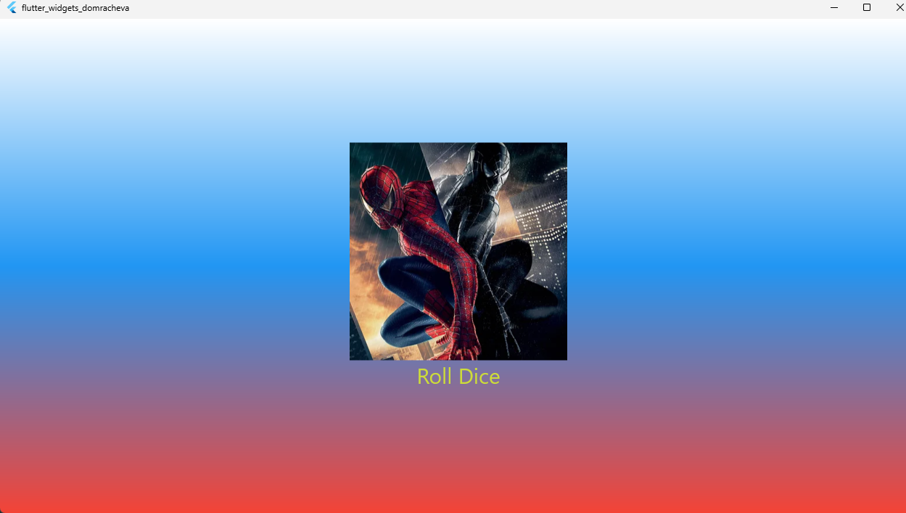

# Лабораторная работа №4-5. Flutter: структура UI и компонентный подход
---
## ФИ: Домрачева Полина

## Группа: ИСП-241

## Дата сдачи: 09.10.26
---
## Что изучили

1. **Компонентный подход** — разбиение UI на отдельные классы-виджеты (`GradientContainer`, `StyledText`, `DiceRoller`) и вынос их в отдельные файлы.
2. **StatelessWidget и StatefulWidget** — различия между статичными и изменяемыми виджетами, управление состоянием через `setState()`.
3. **Работа с ресурсами (assets)** — подключение изображений в `pubspec.yaml` и отображение их через `Image.asset`.
4. **Генерация случайных чисел** — использование `Random()` для создания случайного результата броска кубика.
5. **Стилизация и компоновка** — использование `Container`, `BoxDecoration`, `LinearGradient`, `Column`, `TextButton`, `SizedBox` и `EdgeInsets` для создания адаптивного и привлекательного интерфейса.

## Скриншот финального приложения

## Ссылка на репозиторий

[Flutter_Widgets](https://github.com/chipollina/Flutter_Widgets.git)

## Инструкция по запуску 
1. Клонируйте репозиторий:
git clone https://github.com/chipollina/Flutter_Widgets.git

2.Переходите в папку проекта:
cd Flutter_Widgets

3.Установите зависимости:
flutter pub get

4.Запустите приложение в Chrome:
flutter run -d chrome

5.Для выхода из режима запуска, нажмите q в терминале.

## Ответы на вопросы 

#### 1. Зачем выносить виджеты в отдельные файлы? Что изменится если держать всё в main.dart?

Если держать всё в main.dart, файл быстро станет огромным и в нём будет сложно что-то найти. Когда виджеты лежат в отдельных файлах, код удобнее читать, нужный кусок легко найти по имени файла, и один и тот же виджет можно использовать в разных местах, не копируя его. Eсли работают несколько человек, каждый правит свой файл и не мешает остальным.

#### 2. Что такое BuildContext? Почему метод build() принимает его как параметр?

BuildContext — это информация о том, где виджет находится в дереве. Через него виджет узнаёт про тему, размеры и окружение. Flutter передаёт его сам, и build() обязан его принимать — без него виджет не поймёт, где он и как его рисовать.

#### 3. Чем StatelessWidget отличается от StatefulWidget? Приведите пример когда нужен каждый из них.

StatelessWidget не хранит состояние и не меняется - подходит для статичного UI (текст, картинка, фон).

StatefulWidget хранит состояние и умеет перерисовываться через setState(), когда что-то меняется - например, при нажатии кнопки.

#### 4. Почему Random() создаётся на уровне файла, а не внутри rollDice()?

Чтобы генератор создавался один раз, а не заново при каждом нажатии. Так эффективнее, и числа получаются нормально случайными - иначе при быстрых нажатиях они могли бы повторяться.